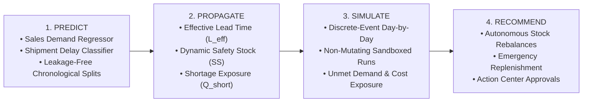
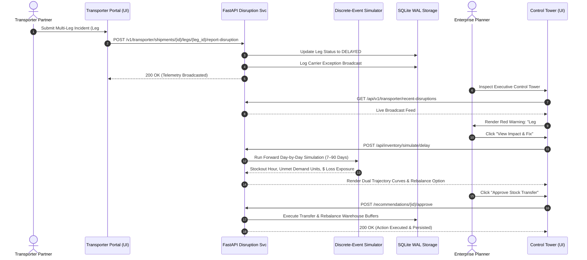

# SupplyIQ: An Integrated Decision-Support and Machine Learning Platform for Supply Chain Intelligence

[](https://fastapi.tiangolo.com)
[](https://react.dev)
[](https://vitejs.dev)
[](https://www.python.org)
[](https://www.sqlite.org/wal.html)
[](https://leafletjs.com)
[](LICENSE)

**SupplyIQ** is an enterprise-grade, multi-tenant supply chain intelligence, disruption simulation, and autonomous decision-support platform. It unites **supervised machine learning**, **statistical inventory engineering**, **unsupervised anomaly detection**, **real-time contextual weather telemetry**, **deterministic daily discrete-event simulation**, and **prescriptive rule-based recommendations** into a unified, high-concurrency web application.

---

## 📑 Table of Contents
- [Core Philosophy & Architecture](#-core-philosophy--architecture)
- [System Architecture & Data Flow](#-system-architecture--data-flow)
- [Key Features & Capabilities](#-key-features--capabilities)
- [Mathematical Formulations](#-mathematical-formulations)
- [Model Performance & Empirical Benchmarks](#-model-performance--empirical-benchmarks)
- [Technology Stack](#-technology-stack)
- [Quick Start Guide](#-quick-start-guide)
  - [Backend Setup](#1-backend-setup)
  - [Frontend Setup](#2-frontend-setup)
- [Demo Access Credentials](#-demo-access-credentials)
- [Verification & Automated Test Suite](#-verification--automated-test-suite)
- [Project Directory Structure](#-project-directory-structure)
- [Academic Publication & Citation](#-academic-publication--citation)
- [License](#-license)

---

## 💡 Core Philosophy & Architecture

Conventional supply chain tools suffer from a fatal structural flaw: **predictive artificial intelligence operates in an operational vacuum**. 

A predictive model might flag a container shipment with an 85% probability of a 3-day delay. In existing ERP systems, this is a disconnected data point. To an enterprise operations director, the actual operational consequence depends entirely on current inventory buffers:
- If the receiving warehouse has **25 days of safety stock**, the delay is inconsequential and requires zero intervention.
- If the receiving facility has only **6 hours of buffer stock remaining**, the delay represents a catastrophic assembly line shutdown.

SupplyIQ resolves this disconnect by organizing its entire engine around an explicit four-stage intelligence workflow:

$$\text{Predict} \longrightarrow \text{Propagate} \longrightarrow \text{Simulate} \longrightarrow \text{Recommend}$$



---

## 🏛️ System Architecture & Data Flow

### Comprehensive Multi-Tier Architecture

```mermaid
flowchart TD
    subgraph Client_Layer ["Client Presentation Layer (React 18 + Vite SPA)"]
        UI_Dash["Executive Control Tower (/overview)"]
        UI_Map["Global Multimodal Mesh Map (/shipments)"]
        UI_Sim["What-If Scenario Lab (/simulator)"]
        UI_Action["Prescriptive Action Center (/recommendations)"]
        UI_Transporter["Transporter Collaborative Portal (/transporter)"]
    end

    subgraph API_Layer ["Application & REST API Layer (FastAPI 0.104+)"]
        Auth_MW["JWT Security & Multi-Tenant Scoping"]
        Route_Inv["/api/inventory (Analytics & Simulators)"]
        Route_Map["/api/network-map (Geospatial Telemetry)"]
        Route_Trans["/api/v1/transporter (Disruption Broadcast)"]
        Route_Rec["/api/recommendations (Prescriptions)"]
    end

    subgraph Engine_Layer ["Core Intelligence & Analytics Engines"]
        ML_Demand["Demand Forecaster (Gradient Boosting / RF)"]
        ML_Delay["Delay Classifier (Gradient Boosting / Logistic)"]
        ML_Anomaly["Logistics Anomaly Engine (Isolation Forest)"]
        Engine_Inv["Multi-Echelon Safety Stock & ABC/XYZ Engine"]
        Engine_Sim["Day-by-Day Discrete-Event Simulation Core"]
        Engine_Weather["Open-Meteo Cache (30-Minute In-Memory TTL)"]
    end

    subgraph Data_Layer ["Enterprise Persistence & Storage Layer"]
        DB[("Relational Store (SQLite WAL Mode / PostgreSQL)")]
        Model_Reg[("Model Artifact Registry (.pkl / Joblib)")]
    end

    Client_Layer <-->|Async RESTful JSON / Axios| API_Layer
    API_Layer --> Engine_Layer
    Engine_Layer <--> Data_Layer
```



### Disruption-to-Action Sequence Flow



---

## ⚡ Key Features & Capabilities

### 1. Live Global Multimodal Corridor & Warehouse Mesh Map
- **Zero-Key Leaflet Engine**: High-performance interactive basemap using OpenStreetMap tiles styled with an inverted dark control-room theme.
- **Dynamic Warehouse Health Beacons**:
  - 🔴 **Red Marker**: Critical Deficit ($I < 0.7 \times SS$) — High stockout exposure.
  - 🟢 **Green Marker**: Healthy Surplus ($I > 1.5 \times SS$) — Eligible stock donor.
  - 🔵 **Blue Marker**: Optimal Buffer Stock.
- **Atomic Multimodal Routes**:
  - ✈️ **Air Cargo Linehaul**: Cyan dashed vectors.
  - 🚢 **Maritime Ocean Freight**: Solid blue vectors.
  - 🚆 **Intermodal Rail**: Solid orange vectors.
  - 🚛 **Highway Drayage**: Solid emerald green vectors.
  - ⚠️ **Delayed / Disrupted Legs**: High-visibility red vectors with delay hours and incident descriptions.
- **Self-Healing Rebalancing Links**: Golden dashed lines indicating automated transfer recommendations between surplus and deficit facilities with transfer quantities and projected cost savings.

### 2. Collaborative Transporter Portal
- Dedicated interface for carrier logistics partners with strict role isolation.
- Transporters manage assigned shipments, confirm pickups, and report multi-leg disruptions.
- Automated ripple simulations quantify the operational consequences of carrier delays before they manifest physically.

### 3. Non-Destructive What-If Simulation Lab
- Evaluates scenarios over customizable 7–90 day forward horizons.
- Models demand surges (e.g., $1.5\times$ holiday multiplier) and shipment arrival delays simultaneously.
- Operates in ephemeral memory: production inventory tables are never mutated during simulation runs.

### 4. Enterprise Concurrency & Bundle Optimization
- **SQLite Write-Ahead Logging (WAL)**: Configured with `PRAGMA journal_mode=WAL;`, `PRAGMA synchronous=NORMAL;`, and `PRAGMA busy_timeout=15000;` to eliminate database locking under parallel read-write stress.
- **Telemetry Micro-Caching**: In-memory caching for Open-Meteo weather API calls reduces geospatial query times from $>5\text{ s}$ to **$<35\text{ ms}$**.
- **Route-Level Code Splitting**: Frontend routes split using `React.lazy()` and `Suspense`, cutting initial load payload under 650 kB.

---

## 📐 Mathematical Formulations

### 1. Bivariate Dynamic Safety Stock ($SS$)
Unlike naive formulas that assume constant vendor lead times, SupplyIQ calculates safety stock by capturing variance in both customer demand ($\sigma_D$) and supplier delivery lead time ($\sigma_L$):

$$SS = Z \sqrt{\bar{L}\sigma_D^2 + \bar{D}^2\sigma_L^2}$$

*Where:*
- $\bar{D}$: Average daily customer demand.
- $\sigma_D$: Standard deviation of daily demand.
- $\bar{L}$: Mean vendor lead time (days).
- $\sigma_L$: Standard deviation of vendor lead time (days).
- $Z$: Service-level factor (e.g., $Z = 1.65$ represents a 95% cycle service level).
*Fallback:* When lead-time history is insufficient, $\sigma_L = 0 \implies SS = Z \sigma_D \sqrt{\bar{L}}$.

### 2. Reorder Point ($ROP$) & Shortage Quantification
Under normal operating lead times:
$$ROP = \bar{D}\bar{L} + SS$$

When a shipment incurs an estimated delay $d$, effective lead time expands to $L_{\text{eff}} = \max(1, \bar{L} + d)$. The revised reorder point and projected shortage quantity ($Q_{\text{short}}$) are:
$$ROP = \bar{D} L_{\text{eff}} + SS$$
$$Q_{\text{short}} = \max\Big(0, \bar{D} L_{\text{eff}} + SS - I - Q_{\text{in}}\Big)$$
*Where $I$ is on-hand stock and $Q_{\text{in}}$ is open incoming supply.*

### 3. Composite Live Risk Score ($R_{\text{live}}$)
Combines predictive machine learning probability with live contextual weather and news indicators:
$$R_{\text{live}} = 0.70 P_{\text{delay}} + 0.20 R_{\text{weather}} + 0.10 R_{\text{news}}$$
*If weather or news telemetry is unavailable, weights are automatically renormalized.*

### 4. Supplier Operational Risk Score ($R_{\text{sup}}$)
$$R_{\text{sup}} = \text{clip}\Big(60(1-\rho) + 25\delta + 10\epsilon + 10\max(0, c-1), 0, 100\Big)$$
*Where $\rho$ is reliability ($0–1$), $\delta$ is historical delay rate, $\epsilon$ is defect rate, and $c$ is relative cost index.*

---

## 📊 Model Performance & Empirical Benchmarks

Evaluated on historical supply chain benchmarks (including DataCo Supply Chain Dataset and U.S. BTS multimodal transport records) using strict chronological hold-out validation:

| Analytical Task | Algorithm | Metric | SupplyIQ Achieved | Baseline / Reference |
| :--- | :--- | :---: | :---: | :---: |
| **Demand Forecasting** | Gradient Boosting Regressor | **MAE** | **16.00** | Seasonal Naive Baseline: **24.70** (35.2% error reduction) |
| **Demand Forecasting** | Random Forest Regressor | **MAE** | **17.40** | Seasonal Naive Baseline: **24.70** |
| **Shipment Delay Classification** | Balanced Gradient Boosting | **ROC-AUC** | **0.750** | Random Guess: **0.500** |
| **Shipment Delay Classification** | Balanced Logistic Regression | **ROC-AUC** | **0.684** | Random Guess: **0.500** |
| **Delay Duration Regression** | Gradient Boosting Regressor | **$R^2$** | **0.142** | Mean Baseline: **0.000** |
| **Unsupervised Anomaly Detection**| Isolation Forest ($n=100$) | **Contamination**| **0.050** | Reliably isolates logistics distance-weight outliers |

---

## 🛠️ Technology Stack

| Layer | Technologies Used |
| :--- | :--- |
| **Backend Framework** | Python 3.11, FastAPI, Pydantic v2, Uvicorn (ASGI) |
| **Database & ORM** | SQLite 3 (WAL Mode Enabled), SQLAlchemy 2.0, Alembic |
| **Machine Learning** | scikit-learn, NumPy, Pandas, Joblib, SHAP (TreeExplainer) |
| **Frontend Framework** | React 18, Vite 8, TypeScript, Axios |
| **Mapping & Geospatial** | Leaflet 1.9, React-Leaflet 5.0, OpenStreetMap Tiles |
| **UI Styling & Charts** | TailwindCSS, Vanilla CSS Variables, Lucide-React, Recharts |
| **Telemetry & Weather** | Open-Meteo REST API (Free, zero-key tier) |
| **Testing & Quality** | Pytest, Pytest-Asyncio, ESLint |

---

## 🚀 Quick Start Guide

### Prerequisites
- Python 3.11+
- Node.js 18+ & npm

---

### 1. Backend Setup

```bash
cd backend

# Create and activate virtual environment
python -m venv venv

# Windows (PowerShell):
.\venv\Scripts\activate
# Linux / macOS:
source venv/bin/activate

# Install dependencies
pip install -r requirements.txt

# Initialize database schema and seed realistic enterprise datasets
python -c "from app.database import init_db; init_db()"
python seed_vanguard_dataset.py

# Start the FastAPI server
uvicorn app.main:app --host 127.0.0.1 --port 8000 --reload
```
- **Interactive Swagger Documentation**: `http://127.0.0.1:8000/docs`
- **Redoc Interface**: `http://127.0.0.1:8000/redoc`

---

### 2. Frontend Setup

```bash
cd frontend

# Install Node dependencies
npm install

# Start Vite development server
npm run dev
```
- **Web Application URL**: `http://localhost:5173`
- **Production Build**: `npm run build`

---

## 🔑 Demo Access Credentials

The platform includes pre-seeded multi-tenant enterprise companies:

| User Role | Email | Password | Tenant / Scope |
| :--- | :--- | :--- | :--- |
| **Enterprise Planner** | `admin@vanguard-aero.com` | `vanguard123` | **Vanguard Aerospace & Robotics** (6 DCs, 15 SKUs, Multimodal Mesh Map, What-If Lab, Action Center) |
| **Enterprise Planner** | `admin@dataco.com` | `dataco123` | **DataCo Global Supply Chain** (5 DCs, Global routes) |
| **Transporter Partner** | `ops@pacificintermodal.com` | `carrier123` | **Pacific Intermodal Logistics** (Dedicated Carrier Disruption Portal) |
| **Transporter Partner** | `driver@apexlogistics.com` | `password123` | **Apex Logistics Fleet** |

---

## 🧪 Verification & Automated Test Suite

SupplyIQ includes an automated test suite verifying mathematical invariants, data contracts, and security boundaries:

```bash
cd backend
.\venv\Scripts\pytest tests/ -v
```

### Key Test Suites:
- `test_inventory_intelligence_and_simulator.py`: Validates 10 core simulation invariants (non-negative stock balances, causality, read-only DB isolation, zero-delay identity).
- `test_action_approvals_and_transfers.py`: Tests approval persistence and physical inventory transfers between warehouses.
- `test_collaborative_disruption.py`: Tests carrier exception reporting, multi-leg sequencing, and automated broadcast feeds.
- `test_security_hardening.py`: Verifies JWT authentication boundaries and cross-tenant data isolation.
- `test_demand_forecasting.py`: Verifies chronological hold-out splits and recursive forecasting.

---

## 📁 Project Directory Structure

```
supply-chain-intelligence/
├── backend/
│   ├── alembic/                # Database schema migration scripts
│   ├── app/
│   │   ├── auth/               # JWT authentication, RBAC & hashing
│   │   ├── models/             # SQLAlchemy ORM models (Shipment, Leg, Inventory, etc.)
│   │   ├── routes/             # FastAPI REST endpoint routers
│   │   │   ├── inventory.py    # Inventory explorer, replenishment & simulation APIs
│   │   │   ├── network_map.py  # Geospatial topology & telemetry endpoints
│   │   │   ├── transporter.py  # Carrier disruption portal endpoints
│   │   │   ├── recommendations.py # Action Center prescription endpoints
│   │   │   └── ...
│   │   ├── schemas/            # Pydantic request & response validation contracts
│   │   └── services/           # Mathematical algorithms & ML pipelines
│   │       ├── inventory_analytics_service.py # ABC/XYZ & Aging analytics
│   │       ├── inventory_simulator_service.py # Discrete-event simulator core
│   │       ├── replenishment_service.py       # Safety stock & transfer optimization
│   │       ├── weather_service.py             # Open-Meteo cache & coordinates registry
│   │       └── ...
│   ├── tests/                  # Pytest automated test suites
│   ├── supplyiq.db             # Pre-configured SQLite database (WAL mode)
│   └── trained_models/         # Serialized scikit-learn model registry (.pkl)
├── frontend/
│   ├── src/
│   │   ├── components/         # Reusable UI components
│   │   │   ├── NetworkMapModal.tsx # Interactive Leaflet multimodal mesh map
│   │   │   ├── Sidebar.jsx     # Navigation sidebar
│   │   │   └── ...
│   │   ├── context/            # Alert & Notification Contexts
│   │   ├── pages/              # Core operational views
│   │   │   ├── Overview.jsx    # Executive Control Tower Dashboard
│   │   │   ├── Shipments.jsx   # Shipment Control Tower & Map Trigger
│   │   │   ├── Simulator.jsx   # Delay & Demand Simulation Lab
│   │   │   ├── TransporterPortal.tsx # Carrier Exception Logging Portal
│   │   │   └── ...
│   │   └── services/           # Axios API client bindings
│   └── package.json
└── docs/                       # Technical reports, specs, and audits
```

---

## 📜 Academic Publication & Citation

This platform forms the experimental foundation of the academic research paper:

> **"SupplyIQ: An Integrated Decision-Support and Machine Learning Architecture for Supply Chain Intelligence"**  
> *Authors: Dr. Aslam P Nandyal, Alok P Das, Adith Krishna R, Aravind Suresh, B Bharath.*  
> *Department of Computer Science and Engineering (Data Science), Alva's Institute of Engineering and Technology, Moodbidri, Karnataka (Affiliated to Visvesvaraya Technological University, Belagavi).*

- **Camera-Ready LaTeX Source**: [`SupplyIQ_Research_Paper_CameraReady.tex`](../SupplyIQ_Research_Paper_CameraReady.tex)
- **VTU B.E. Project Report**: [`VTU_BTech_Project_Report_SupplyIQ.txt`](../VTU_BTech_Project_Report_SupplyIQ.txt)

---

## ⚖️ License
This project is licensed under the MIT License — see the [LICENSE](LICENSE) file for details.
